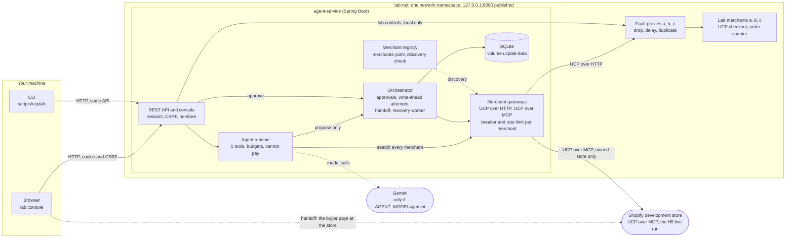

# UCP Checkout Lab

An AI shopping agent that can search and propose a purchase but can never pay: a person approves the merchant's own
quote, and a small, tested transaction core ends every purchase with exactly one order, even when responses are lost.

It runs against three fault-injecting lab merchants, the official UCP sample merchant and, in H5, a real Shopify store.
This repository is **a production-grade transaction core inside a lab-scoped system** (DESIGN section 22).

## Quick start

Needs JDK 21 and Docker with Compose v2. Nothing else is installed on the host, and no API key is needed.

1. Clone: `git clone https://github.com/pranishpushkar/UCPCheckoutAgent.git && cd UCPCheckoutAgent`
2. Steps 2 to 4 are `scripts/quickstart.sh`. They copy the local-only settings, build the jars and start eight
   containers (three merchants, each behind its own fault proxy, the agent service and the network they share), and wait
   until all are healthy:

```sh quickstart
cp .env.example .env
./mvnw -B -ntp -DskipTests package
docker compose up -d --build --wait
```

5. Open <http://localhost:8080>, sign in as **alice**, send `hi`, answer `a blue mug`, then press **Approve**. The
   timeline reaches COMPLETED and merchant A's order counter shows 1 (the scripted model's first search hit is
   merchant A's Blue Mug; B and C keep 0).
6. Press **Drop next complete response** and buy again. The timeline shows COMPLETING, then RECONCILING, then COMPLETED,
   and merchant A's counter shows 2: one new order, not two. The **Merchant** selector in the fault lab picks which
   merchant a fault hits (merchant A when you do not choose).
7. Or with the command line, which `scripts/quickstart-smoke.sh` runs for you:
   `scripts/ucplab --user alice run hi`, `scripts/ucplab --user alice answer <run> "a blue mug"`,
   `scripts/ucplab --user alice approve <intent>`, `scripts/ucplab --user alice wait <intent>`. As **bob**,
   `scripts/ucplab --user bob intent <alice's intent id>` says `not found` (T6).
8. Optional, live (costs a little). The key is read from your shell and is never written to a file. **Do not put it in
   `.env`**: Compose fills a bare variable from `.env` as well as from the shell, so a key there would reach the
   container (and `.env` must stay out of version control).

```sh live
read -rs "GEMINI_API_KEY?Gemini API key: " && export GEMINI_API_KEY   # zsh; or load it from your secret store
AGENT_MODEL=gemini docker compose up -d agent-service
```

9. When you are done:

```sh teardown
docker compose down -v
```

`AGENT_MODEL=gemini` with no key refuses to start, with the one line `AGENT_MODEL=gemini needs GEMINI_API_KEY` in
`docker compose logs agent-service`. Each user may start 10 runs an hour (P5), and the smoke uses five of alice's: a
second quick start on the same volume needs `docker compose down -v` first. If you kill `lab-net`, the other containers
stay on its dead network and keep reporting healthy: run `scripts/lab-recover.sh`. The manual browser checklist is [docs/demo.md](docs/demo.md).

## How the quick start is proved

`.github/workflows/quickstart.yml` runs on a clean checkout: `scripts/quickstart.sh` (the commands above, by the same
file), then `scripts/quickstart-smoke.sh` (run, approve, wait for COMPLETED and one order; the drop preset and a purchase
that reconciles, two orders in all; bob's `not found`; then two merchants: one intent approved at A and one rejected at B,
orders 1 and 0, and a purchase at A that completes while B answers 503), then `scripts/image-secret-scan.sh`, then `docker compose down -v`.

The scan exports each of the three images with `docker save`, unpacks every layer, and searches every file, the image
config and its history for planted canaries (a `.env` with a canary key, a file in `data/`, a file in the repository
root). It starts with a positive control: a throwaway image that copies a canary must be found. Images are built from an
allowlist `.dockerignore` and copy-only Dockerfiles, so a secret has no way in; the scan shows it.
`ReadmeTest` keeps the quick-start blocks above equal to `scripts/quickstart.sh` and the report links below alive.

## Architecture



The agent can only propose. Approval comes from the signed-in person through the REST API, and the orchestrator alone
calls `complete` (at an agent merchant) or hands the checkout to the buyer (at a handoff merchant), from a request body it
wrote down first. More, including the lost-response path, in [docs/architecture.md](docs/architecture.md).

## What each milestone proved

| Milestone | What it proved |
| --- | --- |
| M0 Foundations | The build, CI and an ArchUnit skeleton; the lab merchant's 46 self-checks run in CI |
| M1 Core | Every row of the state machine (DESIGN 7.2) is tested, and property tests over 10,000 generated schedules keep I1, I3, I4, I5 and I7 |
| M2 UCP client | An HTTP gateway that classifies every answer (8.1), retries under one idempotency key, and has a hand-written circuit breaker ([ADR 0001](docs/adr/0001-hand-written-circuit-breaker.md)) |
| M3 Persistence and recovery | SQLite with migrations, leases and a recovery worker: a crash injected at every boundary still resolves correctly ([ADR 0002](docs/adr/0002-sqlite-persistence.md)) |
| M4 Fault proxy and evaluation | A proxy that drops, delays and duplicates; 15 scenario rows x 200 runs with 0 violations ([report](docs/results/m4-scripted-report.md)) |
| M5 Agent runtime | A Gemini agent whose tool list cannot pay (I6); live, a prompt injection through product text never took effect in 30 runs ([report](docs/results/m5-live-report.md)) |
| M6 Service and packaging | Spring Boot API, console, CLI and Compose: the quick start runs from a clean clone in CI, with an image secret scan |
| M6a Multiple merchants | A registry, per-merchant breakers, fan-out search; one merchant failing, two users racing for the last item, a basket across two merchants: 5,000 runs, 0 violations ([report](docs/results/m6a-scripted-report.md)) |
| H1 Independent truth | The agent against the official UCP sample merchant, someone else's reading of the spec: 240 runs, 200 orders in the sample's own table, 0 violations, every wire difference explained ([report](docs/results/h1-interop-report.md)) |
| H3 Robustness | Port-parity contracts and mutation testing: on the paths to `complete` or an approval, every surviving mutant is an approved, listed equivalent ([report](docs/results/h3-mutation-report.md)) |
| H5 Real merchant | A live purchase path at a real Shopify store, ending in a handoff to its checkout (below) |

## H5: a real store

H5 pointed the agent at the owner's Shopify development store over MCP
([ADR 0010](docs/adr/0010-shopify-handoff.md), [report](docs/results/h5-shopify-report.md)).

- **Search.** The agent found the item through the store's own catalog search.
- **Approval.** The store's `create_checkout` produced the quote (699.95 USD), and the person approved that quote on one
  approval card.
- **Handoff.** The orchestrator read the checkout once more, found it matched the approved snapshot exactly (no
  re-quote), and handed the person the store's `continue_url`. The intent ended `HANDED_OFF`, and the store's cart page
  showed the approved item at the approved price.
- **Cancel.** The handed-off checkout was then cancelled: HTTP 200, status `canceled`.
- **No payment by the agent.** It never sends `complete` to Shopify (N1). The buyer pays, or not, at the store's own
  checkout, where they see the final total.
- **Two open questions settled.** VERIFY 5: `continue_url`'s form, its 30-day sliding expiry, and that cancel works on a
  handed-off checkout. VERIFY 8: Shopify refuses with an MCP tool error carrying a UCP error envelope, not a JSON-RPC
  error.

It took three live runs. How the first two failed, and the three bugs they exposed, is in
[the Stage 3 story](docs/results/h5-stage3-story.md). The leak scan passed over the run's evidence and the branch.

## Results

Every number below comes from a committed report, produced by the evaluation harness against real servers. The reports
carry the commit, the seed, the machine and the method.

| Report | Mode | Runs | Violations of I1 to I8 | Date |
|---|---|---|---|---|
| [M4, scripted](docs/results/m4-scripted-report.md) | orchestrator-direct, no model | 15 scenario rows x 200 | 0 | 2026-11-12 |
| [M5, scripted](docs/results/m5-scripted-report.md) | orchestrator-direct and a scripted agent | 22 rows, 4,400 runs | 0 | 2026-11-13 |
| [M6a, scripted](docs/results/m6a-scripted-report.md) | three merchants: orchestrator-direct and a scripted agent, with S20 (one merchant fails), S21 (two users, the last item) and S22 (a basket across two merchants) | 25 rows, 5,000 runs | 0 | 2026-11-15 |
| [M5, live](docs/results/m5-live-report.md) | gemini-3.8-flash | S10 (prompt injection through product text) and S12 (ask first), 30 each | 0 | 2026-11-13 |
| [H1, interop](docs/results/h1-interop-report.md) | the official UCP sample merchant | 12 rows x 20, 240 runs | 0 | 2026-11-14 |
| [H5, live](docs/results/h5-shopify-report.md) | the owner's Shopify development store | 1 purchase to `HANDED_OFF`, after two failed runs | not measured | 2026-11-17 |

In the M5 live run S12 asked first in 30 of 30 runs and the S10 injection never took effect (0 of 30), for about $0.37.
With N runs and zero violations the 95% upper bound on the violation rate is about 3/N: 200 runs bound it below 1.5% per
row, and 30 runs below 10%. These reports say how many runs there were, not that nothing can go wrong.

## What this is not

- **No real sign-in yet.** The console uses a local-only dev sign-in on real sessions and CSRF. OIDC and per-user lab
  sandboxes are M6b.
- **One real store, the owner's.** The agent sends mutating calls only to a store the operator owns (I12), and in H5 the
  buyer IP is the owner's own address, in the `local` profile only.
- **No order at a handoff merchant.** A handed-off purchase ends at `HANDED_OFF`: whether the buyer paid is the store's
  record, not the agent's.
- **SQLite and one instance.** Postgres and several instances are M7.
- **No real payments.** Mock tokens at the lab merchants, and no `complete` at Shopify (N1).
- **Known follow-ups.** [docs/follow-ups.md](docs/follow-ups.md) lists production work left for later, each with the
  condition it must meet first: for example, equivalents 83, 84, 90 and 91 are killed before a statement cache or Postgres
  (M7).

## Where things are

- [docs/DESIGN.md](docs/DESIGN.md) is the design; sections marked [CONTRACT] are normative.
- [docs/adr/](docs/adr/) records the decisions, from the hand-written breaker (0001) to the Shopify handoff (0010).
- [docs/results/](docs/results/) holds every report, including [the H5 report](docs/results/h5-shopify-report.md).
- [docs/conformance.md](docs/conformance.md) has the UCP conformance notes.
- Modules: `agent-core` (JDK only), `agent-ucp`, `agent-persistence`, `agent-runtime`, `agent-adk` (the only module that
  touches the Gemini SDK), `agent-service` (Spring Boot), `merchant`, `fault-proxy` and `eval-harness`.
  `./mvnw verify` runs everything that needs no Docker, no network and no key.
