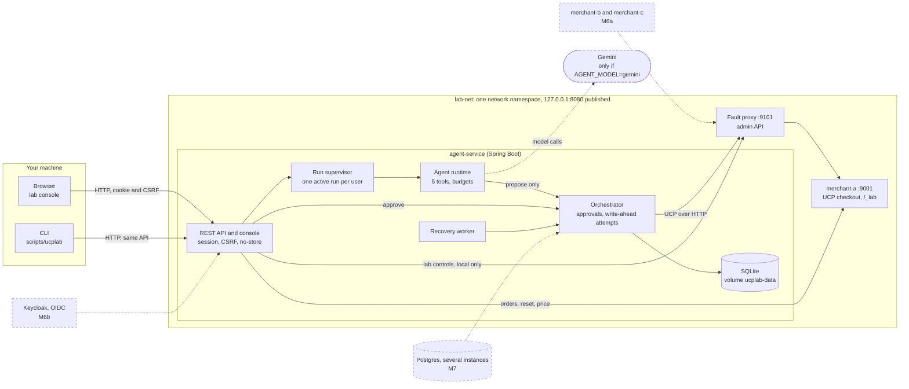

# UCP Checkout Lab

An AI agent that can shop but cannot pay. It searches a merchant's catalog, proposes a purchase and waits. The person
approves a quote the *merchant* produced; only then does a small, tested transaction core call `complete`. A lab
makes the hard case reproducible: the merchant creates the order and the response never arrives. The agent must end
with exactly one order, and the evaluation checks it.

This repository is **a production-grade transaction core inside a lab-scoped system** (DESIGN section 22).

## Quick start

Needs JDK 21 and Docker with Compose v2. Nothing else is installed on the host, and no API key is needed.

1. Clone: `git clone https://github.com/pranishpushkar/UCPCheckoutAgent.git && cd UCPCheckoutAgent`
2. Steps 2 to 4 are `scripts/quickstart.sh`. They copy the local-only settings, build the jars and start four
   containers, and wait until all are healthy:

```sh quickstart
cp .env.example .env
./mvnw -B -ntp -DskipTests package
docker compose up -d --build --wait
```

5. Open <http://localhost:8080>, sign in as **alice**, send `hi`, answer `a blue mug`, then press **Approve**. The
   timeline reaches COMPLETED and the order counter shows 1.
6. Press **Drop next complete response** and buy again. The timeline shows COMPLETING, then RECONCILING, then COMPLETED,
   and the counter shows 2: one new order, not two.
7. Or with the command line, which `scripts/quickstart-smoke.sh` runs for you:
   `scripts/ucplab --user alice run hi`, `scripts/ucplab --user alice answer <run> "a blue mug"`,
   `scripts/ucplab --user alice approve <intent>`, `scripts/ucplab --user alice wait <intent>`. As **bob**,
   `scripts/ucplab --user bob intent <alice's intent id>` says `not found` (T6).
8. Optional, live (costs a little). The key is read from your shell and is never written to a file. **Do not put it in
   `.env`**: Compose fills a bare variable from `.env` as well as from the shell, so a key there would reach the
   container (and `.env` must stay out of version control).

```sh live
read -rs "GEMINI_API_KEY?Gemini API key: " && export GEMINI_API_KEY   # zsh; or load it from your secret store
AGENT_MODEL=gemini docker compose up -d agent-service
```

9. When you are done:

```sh teardown
docker compose down -v
```

`AGENT_MODEL=gemini` with no key refuses to start, with the one line `AGENT_MODEL=gemini needs GEMINI_API_KEY` in
`docker compose logs agent-service`. Each user may start 10 runs an hour (P5): a second quick start on the same volume
needs `docker compose down -v` first. The manual browser checklist is [docs/demo.md](docs/demo.md).

## How the quick start is proved

`.github/workflows/quickstart.yml` runs on a clean checkout: `scripts/quickstart.sh` (the commands above, by the same
file), then `scripts/quickstart-smoke.sh` (run, approve, wait for COMPLETED and one order; the drop preset and a purchase
that reconciles, two orders in all; bob's `not found`), then `scripts/image-secret-scan.sh`, then `docker compose down -v`.

The scan exports each of the three images with `docker save`, unpacks every layer, and searches every file, the image
config and its history for planted canaries (a `.env` with a canary key, a file in `data/`, a file in the repository
root). It starts with a positive control: a throwaway image that copies a canary must be found. Images are built from an
allowlist `.dockerignore` and copy-only Dockerfiles, so a secret has no way in; the scan shows it.
`ReadmeTest` keeps the quick-start blocks above equal to `scripts/quickstart.sh` and the report links below alive.

## Architecture



More, including the lost-response path, in [docs/architecture.md](docs/architecture.md).

## Results

Every number below comes from a committed report, produced by the evaluation harness against real servers. The reports
carry the commit, the seed, the machine and the method.

| Report | Mode | Runs | Violations of I1 to I8 | Date |
|---|---|---|---|---|
| [M4, scripted](docs/results/m4-scripted-report.md) | orchestrator-direct, no model | 15 scenario rows x 200 | 0 | 2026-11-12 |
| [M5, scripted](docs/results/m5-scripted-report.md) | orchestrator-direct and a scripted agent | 22 rows, 4,400 runs | 0 | 2026-11-13 |
| [M5, live](docs/results/m5-live-report.md) | gemini-3.8-flash | S10 (prompt injection through product text) and S12 (ask first), 30 each | 0 | 2026-11-13 |

In the live run S12 asked first in 30 of 30 runs and the S10 injection never took effect (0 of 30). It cost about
$0.37 for 60 runs, about $0.006 a run. With N runs and zero violations the 95% upper bound on the violation rate is about
3/N, so 200 runs bound it below 1.5% per row, and 30 runs below 10%: these reports say how many runs there were, and
not that nothing can go wrong.

## What M6 is not

- **No real sign-in yet.** The console uses a local-only dev sign-in on real sessions and CSRF. OIDC with Keycloak
  arrives in M6b, with per-user lab sandboxes; until then lab rules are global to the one proxy.
- **One merchant.** `merchant-a` only. Merchants b and c, and the registry, are M6a.
- **SQLite and one instance.** A single service instance on a named volume. Postgres and several instances are M7
  (including 21.3's rule that the policy counters move inside the insert's transaction).
- **No real payments.** Mock tokens only (N1).

## Where things are

`docs/DESIGN.md` is the design (sections marked [CONTRACT] are normative), `docs/adr/` records the decisions,
`docs/conformance.md` the UCP conformance notes. Modules: `agent-core` (JDK only), `agent-ucp`, `agent-persistence`,
`agent-runtime`, `agent-adk` (the only module that touches the Gemini SDK), `agent-service` (Spring Boot), `merchant`,
`fault-proxy` and `eval-harness`. `./mvnw verify` runs everything that needs no Docker and no key.
