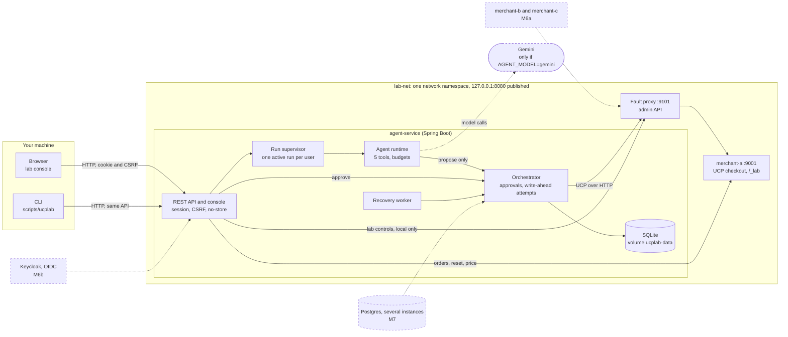
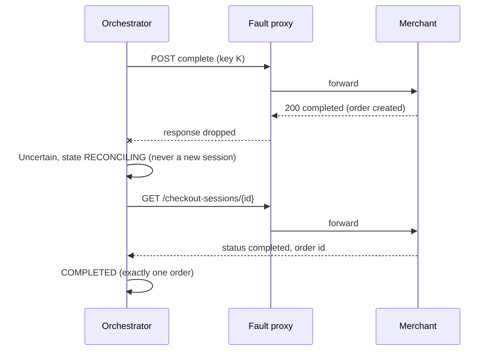

# Architecture (as M6 built it)

The stack of `docker compose up`: four containers sharing one network namespace. The merchant and the fault proxy
listen on loopback only (the merchant's source is frozen; the proxy's contract says 127.0.0.1), so `lab-net` owns the
namespace and the other three join it. Only `127.0.0.1:8080` is published, for the console and the REST API.
Dashed boxes are what comes next.

The agent can only propose a purchase. Approval comes from the signed-in person through the REST API, and the
orchestrator alone calls `complete`, with a deterministic idempotency key, from a request body it wrote down first.

## The lost-response path (DESIGN 5.4)

The case this project exists to test: the merchant creates the order and the response never arrives.

