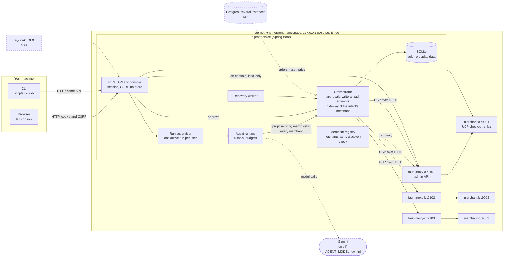
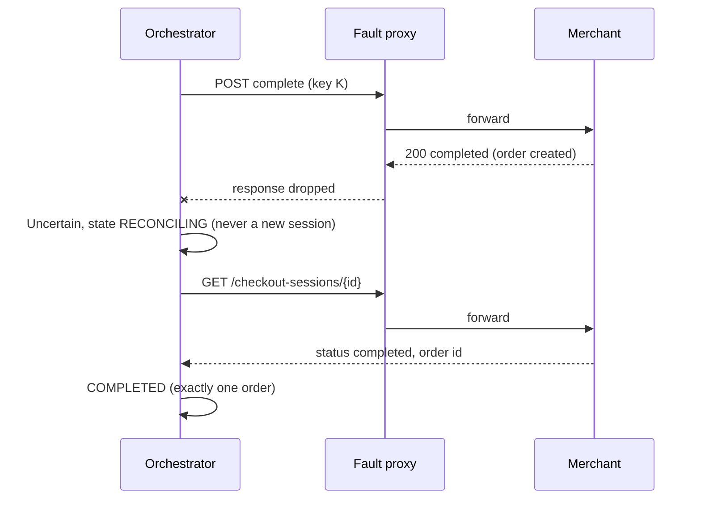

# Architecture (as M6a built it)

The stack of `docker compose up`: eight containers sharing one network namespace. The merchants and the fault proxies
listen on loopback only (the merchant's source is frozen apart from its catalog option; the proxy's contract says
127.0.0.1), so `lab-net` owns the namespace and the other seven join it. Only `127.0.0.1:8080` is published, for the
console and the REST API. There are three merchants, each with a proxy of its own (one proxy has one upstream). The
merchant image is one image: `merchant-b` and `merchant-c` pass `--catalog` with a file from `dev/catalogs/`. Dashed boxes
are what comes next (M6b and M7). The registry reads `merchants.yaml`; a merchant that fails its discovery check starts
SUSPENDED and is left out of search until a check passes again.

The agent can only propose a purchase. Approval comes from the signed-in person through the REST API, and the
orchestrator alone calls `complete`, with a deterministic idempotency key, from a request body it wrote down first.

## The lost-response path (DESIGN 5.4)

The case this project exists to test: the merchant creates the order and the response never arrives.

